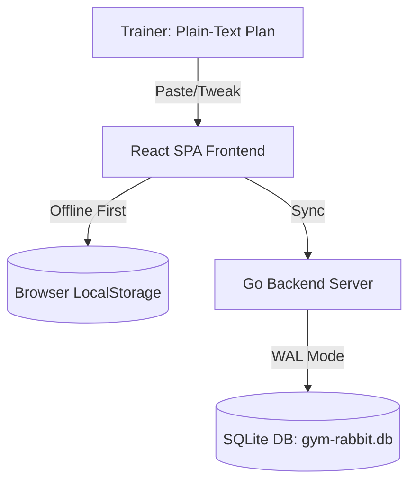

# 🐰 Gym Rabbit — Technical Playbook & Architecture Reference

Welcome to the **Gym Rabbit** developer manual. This document outlines the technical architecture, design principles, containerization, and styling guidelines for any developer or AI agent (like Antigravity / Gemini) building on or maintaining this codebase.

---

## 🎯 The Core Philosophy & UX Flow

Gym Rabbit is a high-focus, distraction-free gym companion designed for two actors:
1. **The Trainer (The Planner):** Prefers zero form friction. Plans routines via a standardized, pipe-delimited plain-text template ("Magic Paste").
2. **The Lifter (The Executor):** Needs an interface optimized for physical exhaustion. Uses giant, sweaty-hand friendly target elements, an ambient screen-wide rest timer, and direct haptic feedback.



---

## 🛠️ Technology Stack & Architecture

Gym Rabbit is configured as a lightweight monorepo containing a React SPA frontend and a Go backend.

### 1. Go Backend (`/main.go`, `/internal/...`)
* **API Framework:** Pure Go standard library (`net/http`) — zero heavy dependencies.
* **Database:** SQLite database using `modernc.org/sqlite`. This is a **pure-Go SQLite driver** that requires no CGO compiler or native C toolchains to build.
* **Database Modes:** Pragmatic optimizations are configured (e.g., WAL mode enabled for concurrent read/write stability).
* **Static Asset Hosting:** When the production frontend is built, the backend checks for the presence of `frontend/dist` and serves the React SPA statically with client-side SPA routing fallbacks.
* **CORS:** Built-in development middleware allowing API integration when running Vite in dev mode on a different port.

### 2. React Frontend (`/frontend/...`)
* **Core:** React 19, TypeScript, and Vite.
* **Styling:** Utility-first TailwindCSS for rapid, fluid layout adjustments.
* **Icons:** Modern, clean SVG icons powered by `lucide-react`.
* **State & Sync:** Offline-first architecture. It instantly persists workout logs locally to browser `localStorage` and syncs/backs up routine blueprints to the Go SQLite server.
* **Device APIs:** Uses the native Web Haptic API (`navigator.vibrate`) to provide direct tactile confirmation when clicking physical UI targets.

---

## 📋 The "Magic Paste" Parser Engine

Workout plans are parsed entirely offline on the client side from a standardized pipe-delimited format. 

### Format Specification
```text
Plan Name: [Descriptive Plan Title]

Block [A-Z]
[Exercise ID]. [Exercise Name] | [Sets]x[Reps] | [Weight] | [Rest]
- [Optional technique cue or note line]
```

### Parsing & UX Rules
* **Auto-Unilateral Mode:** If the `Reps` field contains a `+` symbol (e.g. `8+8`), the engine automatically flags the exercise as unilateral. In gym mode, this automatically splits the giant set logging button into separate **[ LEFT ]** and **[ RIGHT ]** target halves.
* **Delimiter:** Strict pipe (`|`) splitters separate metadata fields.
* **Cues:** Any line starting with a hyphen `-` directly below an exercise is parsed as a form cue/note and shown on the active exercise card.
* **Flexible Weights:** Supports different measurement notations (e.g. `100kg`, `20kg DBs`, `Bodyweight`).

---

## 🐳 Containerization & Deployment

The application is fully containerized and compatible with Docker and Podman.

* **Dockerfile:** Uses a 3-stage build to ensure that compilation dependencies are excluded from the final image, resulting in a minimal, highly secure production build (~15-20MB total):
  1. **Stage 1 (Node.js)**: Runs `npm ci` and builds the React bundle to `dist/`.
  2. **Stage 2 (Golang)**: Statically compiles the Go server with `CGO_ENABLED=0` and flags `-ldflags="-w -s"` to strip debugging symbols.
  3. **Stage 3 (Alpine)**: Standard utility runner copying the static binary and built assets, setting up local ca-certificates.
* **Data Volume:** Mounts persistent SQLite data directly through a host volume bound at `/app/data` (which maps inside the container to `/app/data/gym-rabbit.db`).

### Running the Stack
To launch Gym Rabbit in Docker or Podman:
```bash
# Build and run the service in detached mode
docker compose up -d --build

# Or using Podman
podman compose up -d --build
```
Once started, the application is reachable at **`http://localhost:8080`**.

---

## 🎨 Design System & UX Standards

To keep the application feeling premium, tactile, and highly polished, adhere to the following design system choices:

1. **Sweaty-Hand Friendly:** Completed set targets must be massive (minimum `h-28` target size or equivalent full-width sections) so they can be easily tapped under intense physical strain.
2. **Ambient Rest Screen:** Logging a set triggers a full-screen, high-contrast, black ambient screen with a massive glowing countdown timer to avoid screen-distraction and optimize battery usage.
3. **Barbell Math Sleeve Visualizer:** When inputting target weights, the barbell tool must assume a standard `20kg` bar and graphically represent the exact plates required on the sleeve (standardizing color codes for plates: `25kg` red, `20kg` blue, `15kg` yellow, `10kg` green, etc.).
4. **Volume Comparison Engine:** When calculated session volume is finalized, compare raw tonnage to fun real-world items (e.g., Rhinoceros 🦏, pickup truck 🛻, grand piano 🎹).

---

## 📝 Guidelines for AI Coding Agents

When editing or refactoring this codebase, you **must** adhere to the following guardrails:

* **Keep Go Pure:** Do *not* introduce CGO-dependent database drivers or bindings. Standard pure Go sqlite (`modernc.org/sqlite`) must be maintained.
* **Binary Relativeness:** Ensure all file access (like checking for the `frontend/dist` directory or opening the sqlite DB file) is relative to the binary's working directory so it behaves identically inside and outside Docker.
* **Modern Web APIs:** Always prioritize modern browser standards. For accessibility (a11y) debugging, utilize proper ARIA labeling on highly interactive, oversized set buttons.
* **Glassmorphic Theme:** Retain the dark, premium theme (dark mode by default) using elegant background glassmorphic backdrops, harmonious color accents, and subtle borders. Avoid standard flat browser styles.
* **Clean Code & Commits:** Maintain clear git commit guidelines. Ensure any modified templates or data structure updates are backward-compatible with browser `localStorage`.
