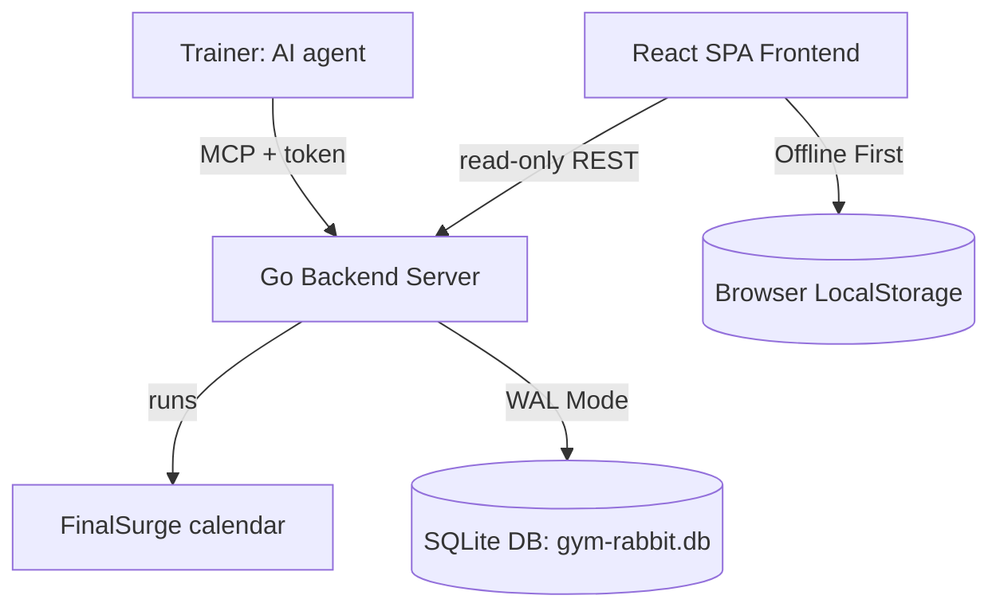

# 🐰 Gym Rabbit — Technical Playbook & Architecture Reference

Welcome to the **Gym Rabbit** developer manual. This document outlines the technical architecture, design principles, containerization, and styling guidelines for any developer or AI agent (like Antigravity / Gemini) building on or maintaining this codebase.

---

## 🎯 The Core Philosophy & UX Flow

Gym Rabbit is a high-focus, distraction-free gym companion designed for two actors:
1. **The Trainer (The Planner):** An AI agent (e.g. Claude) that writes structured workout plans through the MCP server, often together with the running plan in FinalSurge.
2. **The Lifter (The Executor):** Needs an interface optimized for physical exhaustion. Uses giant, sweaty-hand friendly target elements, an ambient screen-wide rest timer, and direct haptic feedback.



---

## 🛠️ Technology Stack & Architecture

Gym Rabbit is configured as a single Go binary containing an embedded zero-build static web frontend (`static/`) and a Go backend.

### 1. Go Backend (`/main.go`, `/internal/...`)
* **API Framework:** Pure Go standard library (`net/http`) — zero heavy dependencies.
* **Database:** SQLite database using `modernc.org/sqlite`. This is a **pure-Go SQLite driver** that requires no CGO compiler or native C toolchains to build.
* **Database Modes:** Pragmatic optimizations are configured (e.g., WAL mode enabled for concurrent read/write stability).
* **Static Asset Hosting:** The `static/` directory is embedded into the binary via `//go:embed static`. When a `static/` directory is present next to the working directory during local development, Go serves from disk for instant refresh; otherwise it serves the embedded files with SPA fallbacks.
* **Routing:** Go 1.22+ method patterns in `newMux` (`main.go`), covered by `main_test.go`. There is no CORS: the browser only ever talks to one origin.

### 2. Zero-Build Web Frontend (`/static/...`)
* **Core:** Vanilla HTML, CSS (`static/style.css`), and ES Modules (`static/app.js`) — no Node.js, npm, React, Tailwind, or bundler required.
* **State & Sync:** Offline-first architecture. Active session progress (`gym-rabbit:session:v1`) is persisted locally to browser `localStorage` and routine blueprints are read from the Go SQLite server (blueprints are written through MCP, see below).
* **Device APIs:** Uses Web Audio API (unlocked on user gesture) and the native Web Haptic API (`navigator.vibrate`) for tactile confirmation and rest timer alerts.

---

## 📋 Workout Data Model

A strength workout is structured JSON, defined in `internal/plan` (Go, with validation) and consumed directly by `static/app.js`. The `jsonschema` tags on the Go structs become the MCP tool schemas, so they are the documentation the agent sees. Field names are snake_case everywhere, the same as the FinalSurge run structure.

```json
{
  "title": "Lower A",
  "scheduled_date": "2026-10-21",
  "notes": "Deload week",
  "blocks": [
    {"exercises": [
      {"name": "Back Squat", "sets": 4, "reps": "6", "weight_kg": 100, "rest_seconds": 150, "cues": ["Brace before descent"]}
    ]},
    {"name": "Superset", "exercises": [
      {"name": "Bulgarian Split Squat", "sets": 3, "reps": "8", "per_side": true, "weight_kg": 16, "load_note": "per dumbbell", "rest_seconds": 0},
      {"name": "Plank", "sets": 3, "reps": "45s", "rest_seconds": 90}
    ]}
  ]
}
```

* **Blocks** group exercises done together (superset/circuit); straight sets are one exercise per block. Unnamed blocks become `Block A`, `Block B`, …. Exercise labels take the block name's trailing letter (`Blok C` → `C1`, `C2`), so they match the coach's plan even with a warm-up block first or gaps in lettering; without one they follow the block's position.
* **`per_side`** splits the giant set logging button into **[ LEFT ]** and **[ RIGHT ]** halves.
* **`reps`** is a string (`"8"`, `"8-10"`, `"AMRAP"`, `"45s"`); the volume calculation uses its first number.
* **`weight_kg`** is a number (omit for bodyweight); **`load_note`** is free text shown next to it.
* **`rest_seconds: 0`** skips the rest screen, to go straight to the next exercise in a superset.
* **Validation** (`plan.Validate`) reports every problem with its path, e.g. `blocks[1].exercises[0].sets`, so the agent can fix them all in one retry.

---

## 🤖 MCP Server (AI Assistant Integration)

The Go backend exposes a [Model Context Protocol](https://modelcontextprotocol.io) server at **`/mcp`** (Streamable HTTP transport, via the official `github.com/modelcontextprotocol/go-sdk`). It lets AI assistants such as Claude read and write workout plans directly.

* **Tools** (one way to do each thing, so the agent never has to choose between duplicates):
  * `upload_training_plan`: the only way to add sessions, one or many. `run` sessions go to the FinalSurge calendar (with Workout Builder structure for the watch); `strength` sessions become Gym Rabbit workouts on that day. The whole batch is validated first and nothing is written if any session is invalid; `dry_run` validates only. Writes across the two systems aren't transactional, so the result reports each session as `created` or `failed`.
  * `list_training_plan(start_date, end_date)`: runs and strength together, ordered by date.
  * `get_strength_workout`, `update_strength_workout` (full replacement of title, date, notes and blocks), `delete_strength_workout`.
  * With FinalSurge configured: `get_run_structure`, `update_run_structure`, `delete_run`.
* **Dates:** every strength workout has a required `scheduled_date` (YYYY-MM-DD). The dashboard shows Upcoming (today highlighted) and Past sessions.
* **FinalSurge:** set `FINALSURGE_EMAIL` and `FINALSURGE_PASSWORD` to enable runs. `internal/finalsurge` is copied from `../finalsurge-mcp` and talks to FinalSurge's **unofficial, reverse-engineered** API: never call `/api/logout`, and keep the builder output matching the captured payloads in `builder_test.go`.
* **Access model:** The REST API is public and **read-only** (`GET /api/workouts`), with one exception: `POST /api/workouts/{id}/performed`, so the gym UI can record finished sessions. Creating, editing and deleting plans happens **only through MCP**; REST writes return 405. The web UI only runs saved plans.
* **Auth:** `/mcp` requires `Authorization: Bearer $MCP_TOKEN` (constant-time compare). If `MCP_TOKEN` is unset, `/mcp` is disabled (503), so the write path is never exposed without a token. Serve it over HTTPS only. For a claude.ai custom connector, configure the same header on the connector.

Connect from Claude Code:
```bash
claude mcp add --transport http gym-rabbit http://localhost:8080/mcp --header "Authorization: Bearer $MCP_TOKEN"
```

---

## 🐳 Containerization & Deployment

The application is fully containerized and compatible with Docker and Podman.

* **Dockerfile:** Uses a 2-stage build to ensure compilation dependencies are excluded from the final image, resulting in a minimal production build:
  1. **Stage 1 (Golang)**: Statically compiles the Go server (with `static/` embedded via `//go:embed`) using `CGO_ENABLED=0` and flags `-ldflags="-w -s"`.
  2. **Stage 2 (Alpine)**: Minimal runner copying the single static binary and setting up ca-certificates and tzdata.
* **Data Volume:** Mounts persistent SQLite data directly through a host volume bound at `/app/data` (which maps inside the container to `/app/data/gym-rabbit.db`).

### Running the Stack
To launch Gym Rabbit in Docker or Podman:
```bash
# Build and run the service in detached mode
docker compose up -d --build

# Or using Podman
podman compose up -d --build
```
Once started, the application is reachable at **`http://localhost:8080`**.

---

## 🎨 Design System & UX Standards

To keep the application feeling premium, tactile, and highly polished, adhere to the following design system choices:

1. **Sweaty-Hand Friendly:** Completed set targets must be massive (minimum `7rem` / `112px` target height or equivalent full-width sections) so they can be easily tapped under intense physical strain.
2. **Ambient Rest Screen:** Logging a set triggers a full-screen, high-contrast, black ambient screen with a massive glowing countdown timer to avoid screen-distraction and optimize battery usage.
3. **Barbell Math Sleeve Visualizer:** Defaults to a standard `20kg` bar (with `15kg`/`25kg` toggles) and graphically represents the exact plates required on the sleeve (standardizing color codes for plates: `25kg` red, `20kg` blue, `15kg` yellow, `10kg` green, etc.).
4. **Volume Comparison Engine:** When calculated session volume is finalized, compare raw tonnage to fun real-world items (e.g., Rhinoceros 🦏, pickup truck 🛻, grand piano 🎹).

---

## 📝 Guidelines for AI Coding Agents

When editing or refactoring this codebase, you **must** adhere to the following guardrails:

* **Keep Go Pure:** Do *not* introduce CGO-dependent database drivers or bindings. Standard pure Go sqlite (`modernc.org/sqlite`) must be maintained.
* **Binary Relativeness:** Ensure all file access (like checking for a local `static/` dev override or opening the sqlite DB file) is relative to the binary's working directory so it behaves identically inside and outside Docker.
* **Modern Web APIs:** Always prioritize modern browser standards. For accessibility (a11y) debugging, utilize proper ARIA labeling on highly interactive, oversized set buttons.
* **Glassmorphic Theme:** Retain the dark, premium theme (dark mode by default) using elegant background glassmorphic backdrops, harmonious color accents, and subtle borders. Avoid standard flat browser styles.
* **Clean Code & Commits:** Maintain clear git commit guidelines. Ensure data structure updates are backward-compatible with browser `localStorage`. Workouts saved in the old Magic Paste text format are dropped on startup, not converted (see `migrate` in `internal/db`).
